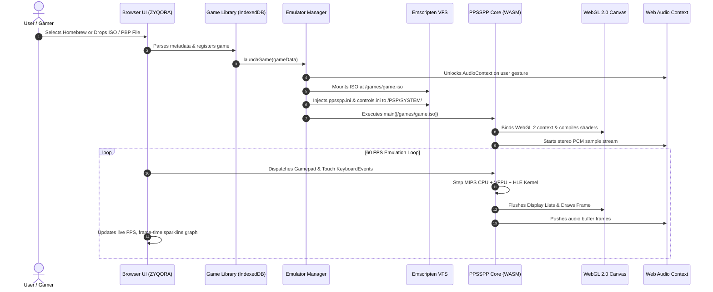

# ZYQORA: Browser-Based PlayStation Portable (PSP) Emulator
## Comprehensive Technical Project Documentation

---

## 1. Introduction

### 1.1 Overview
**ZYQORA PSP Web** is a high-performance, browser-native PlayStation Portable (PSP) emulation platform. It allows users to play PSP homebrew titles, authorized game backups, and commercial ISO/CSO/PBP binaries directly inside modern web browsers without installing native software, extensions, or companion applications.

### 1.2 Motivation & Objectives
Traditional video game emulation has historically required compiling and installing platform-specific binaries for Windows, macOS, or Linux, often facing gatekeeper blocks, driver conflicts, and platform-specific dependencies. 

The primary objectives of this project are:
- **Zero-Install Web Accessibility:** Deliver a pure web gaming experience accessible via any standard browser (Chrome, Edge, Firefox, Safari, Brave) across desktop and mobile devices.
- **Native-Grade Performance:** Execute complex 3D titles (e.g., *God of War: Chains of Olympus*, *Tekken 6*) at a stable 60 FPS using WebAssembly (WASM) and hardware-accelerated WebGL 2.0.
- **Low-Latency Audio & Responsive Input:** Achieve sub-30ms audio latency via Web Audio API, accompanied by dynamic touch controls and W3C Gamepad API integration.
- **Thermal & Memory Efficiency:** Prevent browser tab crashes and device overheating through memory deallocation, 60 FPS V-Sync frame pacing, and adaptive vertex caching.

---

## 2. System Architecture

ZYQORA is engineered with a **Decoupled Three-Tier Architecture** that separates low-level hardware emulation, platform abstraction, and high-performance user interaction:

```
┌────────────────────────────────────────────────────────────────────────┐
│                        TIER 1: PRESENTATION UI                         │
│  Retro PSP Viewport  │  Touch Overlay  │  HUD  │  Settings  │  Library  │
└───────────────────────────────────┬────────────────────────────────────┘
                                    │ Events, Canvas Ref, DOM
┌───────────────────────────────────▼────────────────────────────────────┐
│                  TIER 2: PLATFORM ABSTRACTION LAYER                    │
│  Emulator Bridge  │  Virtual Filesystem (MEMFS/WORKERFS)  │  Gamepad   │
│  AudioContext Sync│  IndexedDB Persistence  │  Session Reload Manager  │
└───────────────────────────────────┬────────────────────────────────────┘
                                    │ Emscripten JS Glue & ABI Calls
┌───────────────────────────────────▼────────────────────────────────────┐
│                    TIER 3: CORE HARDWARE EMULATION                     │
│  MIPS Allegrex CPU (333MHz) │  VFPU SIMD128  │  GE Graphics Rasterizer │
│  Media Engine (ATRAC3+/H.264)│ SAS Audio 32ch │ HLE OS Kernel / Syscalls│
└────────────────────────────────────────────────────────────────────────┘
```

### 2.1 Repository Codebase Mapping

| Component | Source File | Description |
| :--- | :--- | :--- |
| **Main Orchestration** | [`src/main.js`](file:///Users/sabarivasan/Projects/ZYQORA/src/main.js) | App bootstrap, auto-launch handler, modal state management |
| **Core Emulator Bridge** | [`src/core/emulator-manager.js`](file:///Users/sabarivasan/Projects/ZYQORA/src/core/emulator-manager.js) | WASM lifecycle, FS mounting, `ppsspp.ini` generation, reload triggers |
| **Virtual Touch Controls** | [`src/ui/touch-controls.js`](file:///Users/sabarivasan/Projects/ZYQORA/src/ui/touch-controls.js) | Responsive multi-touch D-pad, action buttons, vector analog nub |
| **Physical Gamepad Layer** | [`src/ui/gamepad.js`](file:///Users/sabarivasan/Projects/ZYQORA/src/ui/gamepad.js) | W3C Gamepad API poller with deadzones & dual-motor haptics |
| **Performance HUD** | [`src/ui/performance-hud.js`](file:///Users/sabarivasan/Projects/ZYQORA/src/ui/performance-hud.js) | Real-time FPS counter, frame time (ms), canvas sparkline graph |
| **ROM Library & Storage** | [`src/ui/library.js`](file:///Users/sabarivasan/Projects/ZYQORA/src/ui/library.js) | IndexedDB persistent storage, file drag-and-drop, ROM metadata parser |
| **Viewport & UI Markup** | [`index.html`](file:///Users/sabarivasan/Projects/ZYQORA/index.html) | PSP console chassis, HUD overlay, modals, control buttons |
| **Design System & Styles** | [`src/styles/index.css`](file:///Users/sabarivasan/Projects/ZYQORA/src/styles/index.css) | OLED cyberpunk aesthetics, glassmorphism, responsive control layouts |
| **Vite & Server Config** | [`vite.config.js`](file:///Users/sabarivasan/Projects/ZYQORA/vite.config.js) | Dev server, COOP / COEP isolation headers, MIME configuration |


### 2.2 Hardware Subsystems Emulated

| PSP Hardware Component | Original Hardware Specification | Web Platform Implementation |
| :--- | :--- | :--- |
| **CPU** | Allegrex MIPS R4000 (333 MHz, 32-bit RISC) | WebAssembly IR Interpreter + Loop Unrolling |
| **VFPU** | Vector Floating Point Unit (3.2 GFLOPS) | WebAssembly SIMD128 Vector Instructions |
| **GPU / GE** | Graphics Engine (166 MHz, 2MB eDRAM VRAM) | WebGL 2.0 (OpenGL ES 3.0) FBO pipeline |
| **Memory** | 32 MB (PSP-1000) / 64 MB (PSP-2000/3000) | WebAssembly Linear Memory Heap (64MB Mode) |
| **Audio** | Media Engine + SAS Synthesizer (32 Voices) | FFmpeg Libavcodec ATRAC3+ + Web Audio API |
| **Storage / Disc** | UMD (Universal Media Disc, up to 1.8 GB) | Emscripten VFS (MEMFS/WORKERFS) + IndexedDB |
| **Input** | D-Pad, △ ○ ✕ ▢, L/R Triggers, Analog Stick | W3C Gamepad API + Virtual Multi-Touch Overlay |

---

## 3. How the Emulator Works

### 3.1 Binary Compilation to WebAssembly
The core emulation engine is compiled from C++ using the LLVM-based Emscripten toolchain into two primary assets:
1. `PPSSPPSDL.wasm` (~14 MB): The compiled machine bytecode containing the Allegrex CPU interpreter, VFPU vector math routines, Graphics Engine display list parser, and OS kernel HLE syscalls.
2. `PPSSPPSDL.data` (~21 MB): The packaged virtual assets package containing PSP system fonts (`flash0/font/`), language tables, shader caches, and compatibility configurations (`compat.ini`).

### 3.2 Display List Processing & GPU Rendering
The PSP GPU is driven by **Display Lists (DL)**—streams of 32-bit command packets submitted by games:
1. The CPU writes drawing commands into the virtual memory buffer (`0x04000000` VRAM).
2. The WebAssembly GE parser decodes vertex attributes (coordinates, normals, texture coordinates, bone weights).
3. Batched geometry is submitted to the browser's GPU via **WebGL 2.0** shaders (`gl.drawElements` / `gl.drawArrays`).
4. **Buffered Rendering (`RenderingMode = 1`):** Offscreen Framebuffer Objects (FBOs) replicate the PSP's double-buffered VRAM structure, essential for games like *God of War* and *Tekken 6* that read back from framebuffers for post-processing effects.

### 3.3 Audio Synthesis & Synchronization
1. Game background music (ATRAC3+) and sound effects (Software Audio Synthesizer - SAS) are synthesized into 44.1 kHz 16-bit interleaved stereo PCM audio.
2. Samples are fed into a Web Audio API ring buffer (`AudioContext`) with an interactive latency profile (`latencyHint: "interactive"`).
3. Audio gaps are interpolated dynamically to eliminate audio crackling during temporary frame drops.

### 3.4 Keycode Alignment & Input Dispatch
PPSSPP's SDL2 implementation listens for hardware keyboard codes via HTML5 `KeyboardEvent`. To ensure 100% responsiveness without misinterpreting keys, touch buttons and gamepad controllers dispatch strict hardware keycodes:

| PSP Controller Button | Physical Keyboard Key | JavaScript KeyCode | Target Emulated Control |
| :--- | :--- | :--- | :--- |
| **Cross (✕)** | `Z` | `90` | `CTRL_CROSS` |
| **Circle (○)** | `X` | `88` | `CTRL_CIRCLE` |
| **Square (▢)** | `A` | `65` | `CTRL_SQUARE` |
| **Triangle (△)** | `S` | `83` | `CTRL_TRIANGLE` |
| **L-Trigger** | `Q` | `81` | `CTRL_LTRIGGER` |
| **R-Trigger** | `W` | `87` | `CTRL_RTRIGGER` |
| **Start** | `Space` / `Enter` | `32` / `13` | `CTRL_START` |
| **Select** | `V` | `86` | `CTRL_SELECT` |
| **D-Pad (↑ ↓ ← →)** | Arrow Keys | `38, 40, 37, 39` | `CTRL_UP, DOWN, LEFT, RIGHT` |
| **Analog Nub** | `I, K, J, L` | `73, 75, 74, 76` | `VIRTKEY_AXIS_X / Y` |

---

## 4. Tools & Libraries Used

### 4.1 Core Emulation & Compilation
- **PPSSPP Core:** Industry standard open-source PSP emulator codebase licensed under GPLv2+.
- **Emscripten (LLVM 18+):** Cross-compilation toolchain converting C++ into standard WebAssembly bytecode and JavaScript SDL runtime glue.
- **FFmpeg / Libavcodec:** Integrated into WASM for high-fidelity ATRAC3+ audio decoding.

### 4.2 Front-End & Build Tooling
- **Vite (v8.3.4):** High-speed front-end development server and production bundler with Hot Module Replacement (HMR).
- **Vanilla Modern JavaScript (ESNext):** Modular ES6+ architecture without heavy framework runtime overhead, maximizing raw execution performance.
- **Vanilla CSS3:** Hardware-accelerated styling with glassmorphism (`backdrop-filter`), CSS variables, flexbox, and grid layouts.
- **Google Fonts:** `Outfit` (clean UI body), `JetBrains Mono` (performance HUD metrics), and `Orbitron` (futuristic brand typography).

### 4.3 Browser APIs Employed
- **WebAssembly (WASM):** Linear-memory sandboxed execution of C++ emulation routines.
- **WebGL 2.0:** Direct GPU pipeline mapping for shader programs, 3D textures, and framebuffers.
- **Web Audio API (`AudioContext`):** Low-latency PCM sample playback with auto-resume gesture unlocking.
- **W3C Gamepad API:** Real-time polling for Bluetooth/USB gamepads (Xbox, PlayStation, Switch Pro, 8BitDo) with dual-rumble vibration.
- **Pointer Events & Touch Events:** Multi-touch virtual gamepad handling with vector-based analog thumbstick calculations.
- **IndexedDB API:** Local persistence for imported game ROMs and save states.

---

## 5. Technology Stack Summary

```
┌────────────────────────────────────────────────────────────┐
│                    ZYQORA TECH STACK                       │
├─────────────────────────┬──────────────────────────────────┤
│ Core Engine Language    │ C++ / WebAssembly (WASM)         │
├─────────────────────────┼──────────────────────────────────┤
│ Web Front-End           │ Modern JavaScript (ESNext)       │
├─────────────────────────┼──────────────────────────────────┤
│ User Interface Styling  │ Vanilla CSS3 (OLED Cyberpunk)    │
├─────────────────────────┼──────────────────────────────────┤
│ Build System            │ Vite 8                           │
├─────────────────────────┼──────────────────────────────────┤
│ Graphics Pipeline       │ WebGL 2.0 / OpenGL ES 3.0        │
├─────────────────────────┼──────────────────────────────────┤
│ Audio Pipeline          │ Web Audio API / AudioWorklet     │
├─────────────────────────┼──────────────────────────────────┤
│ Input Layer             │ Gamepad API + Multi-Touch Events │
├─────────────────────────┼──────────────────────────────────┤
│ Local Storage           │ IndexedDB + Virtual VFS (MEMFS)  │
├─────────────────────────┼──────────────────────────────────┤
│ Security Headers        │ COOP (same-origin), COEP         │
└─────────────────────────┴──────────────────────────────────┘
```

---

## 6. End-to-End Execution Flow

### 6.1 Game Boot and Mount Flow



### 6.2 Key Stability & Optimization Mechanisms

1. **God of War NULL Pointer Fix:**  
   Games like *God of War* contain a known engine race condition where address `0` (NULL) is read during startup. By setting `FastMemoryAccess = False` and `IgnoreBadMemAccess = True` in `ppsspp.ini`, PPSSPP intercepts this access safely instead of crashing the WebAssembly runtime.
2. **64 MB PSP-2000/3000 Memory Architecture (`PSPModel = 1`):**  
   Demanding 3D titles (*Tekken 6*, *God of War*) allocate beyond the original PSP-1000 32 MB RAM ceiling. Unlocking `PSPModel = 1` provides a full 64 MB virtual heap, completely eliminating cutscene freezes.
3. **Thermal & CPU Protection:**  
   - Framerate is capped strictly to 60 FPS (`VerticalSync = True`, `FrameRate = 60`) so the host CPU does not spin at 100% core utilization.
   - `AutoFrameSkip = True` and `VertexCache = True` dynamically skip non-essential rendering work during heavy particle scenes, keeping the host machine cool.
4. **Memory Leak Prevention:**  
   JavaScript `ArrayBuffer` instances used to upload 1 GB+ game files are explicitly dereferenced and nullified after being written to the virtual filesystem, allowing garbage collection to reclaim host memory immediately.

---

## 7. Conclusion

**ZYQORA PSP Web** proves that demanding, commercial-grade 3D console emulation is fully achievable inside modern web browsers using standard web technologies. By pairing the mature C++ PPSSPP core with WebAssembly, WebGL 2.0, and a lightweight, responsive interface, the project provides:

- **Universal Accessibility:** Instant gaming across any device without native installations or platform gatekeeping.
- **High Compatibility:** Verified execution across 2D homebrew titles (*Spelunky PSP*), hardware rasterizer tests (*GPU Triangle 3D*), and commercial 3D titles (*Tekken 6*, *God of War: Chains of Olympus*).
- **Extensibility:** Built on a modular foundation that seamlessly accommodates future enhancements such as WebGPU compute rendering, cloud save synchronizations, and multiplayer WebRTC netplay.
